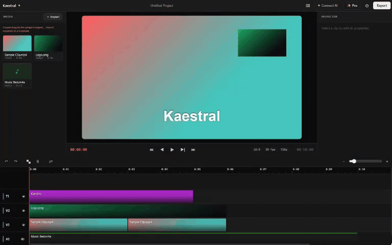

<p align="center">
  
</p>

<p align="center"><strong>Kaestral — the AI-operated video editor for Windows. Describe the edit in Claude, Cursor, or the app; Kaestral cuts, captions, grades, animates, and exports it — entirely on your PC.</strong></p>

<p align="center"><strong>Kaestral has eyes 👀 and ears 👂</strong></p>

<p align="center">It sees your footage (real frame vision) and hears every word (on-device word-level transcription) — so the AI edits what's actually there, not what it guessed.</p>

<p align="center">A real multi-track editor with a full professional feature set, driven by natural language through <strong>55 validated MCP tools</strong> and <strong>25 AI skills</strong>. Everything runs local — your footage never leaves the machine.</p>

<p align="center">
  <a href="https://github.com/prabindersinghh/Kaestral-pro/releases/latest"></a>
  
  <a href="https://www.npmjs.com/package/kaestral"></a>
  
  
  
  
</p>

<p align="center">
  <b>English</b> ·
  <a href="./docs/readme/README.es.md">Español</a> ·
  <a href="./docs/readme/README.zh-CN.md">简体中文</a> ·
  <a href="./docs/readme/README.zh-TW.md">繁體中文</a> ·
  <a href="./docs/readme/README.ja.md">日本語</a> ·
  <a href="./docs/readme/README.ko.md">한국어</a> ·
  <a href="./docs/readme/README.vi.md">Tiếng Việt</a> ·
  <a href="./docs/readme/README.hi.md">हिन्दी</a> ·
  <a href="./docs/readme/README.bn.md">বাংলা</a> ·
  <a href="./docs/readme/README.ar.md">العربية</a> ·
  <a href="./docs/readme/README.it.md">Italiano</a> ·
  <a href="./docs/readme/README.pt-BR.md">Português (Brasil)</a> ·
  <a href="./docs/readme/README.fr.md">Français</a> ·
  <a href="./docs/readme/README.ru.md">Русский</a> ·
  <a href="./docs/readme/README.tr.md">Türkçe</a>
</p>

---

<p align="center">
  
</p>

## See it in action

You type the edit; Kaestral builds it on a real timeline — filler cut, captions on the word, hook
punched in. *(A film Kaestral made from a single prompt.)*

<p align="center">
  
</p>

---

## Install

| | How |
|---|---|
| **Claude Code (one command)** | `claude mcp add kaestral -- npx kaestral` — then just ask for the edit |
| **Windows installer** | [Download v1.0.5](https://github.com/prabindersinghh/Kaestral-pro/releases/latest) → double-click. **Signed auto-updates from 1.0.5 onward.** |
| **npm** | `npx kaestral` (needs Node + FFmpeg on PATH; the installer bundles everything) |
| **Claude Desktop** | one-click [`kaestral.mcpb`](https://github.com/prabindersinghh/Kaestral-pro/releases/latest) from the release |

---

## Everything in one editor

Deep reference for every item: **[docs/FEATURES.md](./docs/FEATURES.md)**.

**🎬 Professional timeline** — multi-track · linked A/V · keyframes · 16 blend modes ·
ripple/split/snap · speed retiming · frame-accurate composited preview.
→ [details](./docs/FEATURES.md#1-the-desktop-editor-windows-1011)

**🤖 AI-operated — 55 MCP tools** over stdio + HTTP; works with Claude Code, Cursor, Claude
Desktop (one-click `.mcpb`), or the in-app chat.
6 read/inspect · 13 timeline editing · 3 text & captions · 3 color & effects · 8 media library ·
3 project · 4 generation · 1 feedback · 2 skills · 3 motion · 6 analysis & perception ·
3 editing primitives (`add_track` · `punch_in` · `freeze_frame`).
→ [details](./docs/FEATURES.md#2-the-mcp-server--55-tools)

**👀👂 Perception (on-device)** — word-level whisper transcription · frame vision (`see_video`) ·
beat + silence detection · palette extraction · scene-cut detection · reference-motion matching.
→ [details](./docs/FEATURES.md#3-perception-all-on-device--nothing-is-uploaded)

**✂️ Word-level editing** — animated word-accurate captions (10 animation presets, karaoke
highlight) · filler-word removal · silence jump-cuts · long-form → ranked shorts (moment mining).
→ [details](./docs/FEATURES.md#4-word-level-editing)

**✨ Generative motion engine** — 24 elements · 11 entrances · working exits · camera moves ·
masks · depth parallax · 7 transitions with beat-snapping · Cinematic Reel pack (9:16) · device
frames. → [details](./docs/FEATURES.md#5-the-generative-motion-engine-compose_motion)

**🎨 Color** — 3-way wheels · RGB + hue curves · LUTs · temperature/tint · highlights/shadows ·
plus blur / sharpen / chroma key / grain / vignette / glow.
→ [details](./docs/FEATURES.md#7-color--effects)

**🔲 Layouts** — side-by-side · top/bottom · PiP corners · 2×2 grid · main+sidebar · three-up.
→ [details](./docs/FEATURES.md#8-layouts)

**📦 Export & interchange** — H.264 / H.265 / ProRes · 720p→4K · Premiere XMEML · Resolve/FCP
FCPXML · SRT captions · `.kaestral` package.
→ [details](./docs/FEATURES.md#9-import--export)

---

## 25 AI skills

Editing playbooks the agent reads on demand (`list_skills` / `read_skill`) — craft, not templates.
→ [details](./docs/FEATURES.md#6-skills--25-editing-playbooks-the-ai-reads)

**Foundations (craft depth)** — `build-in-kaestral` build on the timeline, always ·
`art-direction` the master motion playbook · `shot-recipes` a composable motion grammar ·
`transition-craft` the right transition, tuned · `text-and-typography` on-screen type that reads ·
`color-storytelling` grading with intent · `sound-design` mix, ducking, engineered silence

**Creator & growth** — `hook-engineering` the first three seconds · `retention-editing` pacing for
watch-through · `viral-reel` raw footage to short · `talking-head-cleanup` the standard creator
pass · `thumbnail-and-cover` choosing the cover frame · `caption-styles` modern caption looks ·
`beat-sync-cutting` cuts locked to music

**Production pipelines** — `topic-to-short` idea to editable short · `podcast-to-clips` long
recording to clip set · `broll-planner` b-roll against the script · `promo-ad` hook, benefits,
CTA · `ad-creative` direct-response ad spine · `creative-director` palette, grade, type together

**Agency & delivery** — `brand-kit` one brand system everywhere · `multi-language-delivery` one
edit, many languages · `batch-variants` A/B variants that map back · `client-review-cut` slates,
watermarks, notes workflow · `platform-delivery` per-platform framing and export

---

## Why Kaestral

- **Local-first.** Transcription, vision, beats, rendering, export — all on your machine. Nothing
  uploaded, ever.
- **AI-native.** The AI drives a real editor through validated tools — it isn't a chatbot bolted
  onto one. Every edit lands on a timeline you can still touch.
- **Free and open-source.** GPLv3. No watermarks, no subscriptions.

---

## Pro & Max (waitlist — not yet shipped)

- **Pro:** AI video & image **generation** (prompt → a real clip on your timeline) · translation &
  **dubbing** in Hindi + regional Indian languages · temporally-consistent **upscaling**.
- **Max:** something bigger. Details under wraps.

None of this is in the current build. Join the waitlist from the app's **✨ Pro** button or the
[pricing page](https://kaestral.com/pricing.html). Basic stays free and open source, forever.

---

## Trust

- **310 automated tests** across every pipeline stage — validator, render (pixel-proofed), MCP
  contract, engine, project round-trip, exports.
- Release verification is done **in the packaged, installed app** — a full editing session
  (import → cut → captions → grade → motion → export in three codecs and three aspect ratios)
  driven against the live engine.
- **25/25 skills verified** served over a real stdio handshake.
- **GPLv3**, with upstream **Palmier Pro** attribution retained in [NOTICE.md](./NOTICE.md).

---

## Development

```bash
npm test           # full suite: format round-trip, edit engine, MCP contract, perception, render
npm run typecheck  # strict TS  (tsc --noEmit)
npm run tauri dev  # run the desktop app
npm run tauri build  # build the Windows installer (see docs/UPDATER-SETUP.md for signed releases)
```

Docs worth reading before you dig in:
- [docs/FEATURES.md](./docs/FEATURES.md) — every feature, in detail.
- [docs/MCP-TOOLS.md](./docs/MCP-TOOLS.md) — the 55-tool reference.
- [docs/ARCHITECTURE.md](./docs/ARCHITECTURE.md) — how the pieces fit (editor = hands, LLM = brain).
- [docs/LAUNCH-RUNBOOK.md](./docs/LAUNCH-RUNBOOK.md) — build, publish, and deploy steps.
- [CONTRIBUTING.md](./CONTRIBUTING.md) — how to build, test, and open a PR.

---

## FAQ, community & support

- ❓ **[FAQ.md](./FAQ.md)** — is it free, what's Pro/Max, which Windows, does my data stay local.
- 💬 **[GitHub Discussions](https://github.com/prabindersinghh/Kaestral-pro/discussions)** — questions, ideas, show-and-tell.
- 🎮 **[Discord](https://discord.gg/xwDuQTY6Y)** — chat with the community and the team.
- 🐛 **[Issues](https://github.com/prabindersinghh/Kaestral-pro/issues)** — bugs and feature requests.
- 🙌 **[CONTRIBUTING.md](./CONTRIBUTING.md)** — PRs welcome.

---

## License & credit

**GPLv3.** Kaestral is a derivative work of the upstream **Palmier Pro** by Palmier Inc.
([palmier-io/palmier-pro](https://github.com/palmier-io/palmier-pro), GPLv3), re-implemented for
Windows using the Swift source as an executable specification. This attribution is required by the
GPLv3 and is retained accordingly; Kaestral is not affiliated with or endorsed by Palmier Inc. The
upstream's proprietary cloud generation backend is not part of that repo and is not ported.
Third-party components (whisper.cpp, FFmpeg, Remotion, etc.) retain their own permissive licenses —
see [NOTICE.md](./NOTICE.md).
